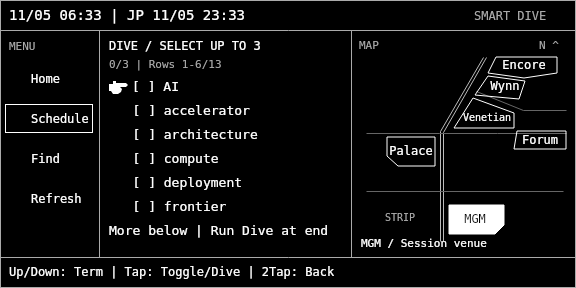
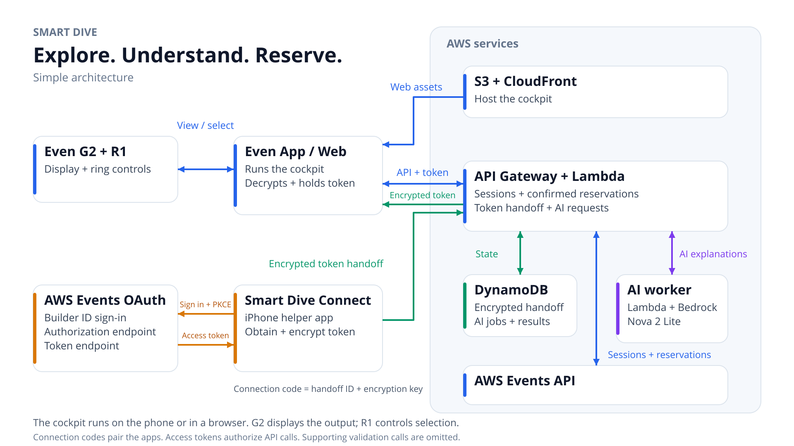

# Smart Dive — Stay in the Moment at re:Invent

Explore re:Invent sessions through Even G2 smart glasses and an R1 ring. After setup, selection replaces typing and speaking: check your schedule, find a session, read its abstract, explore AI explanations, and explicitly confirm a seat reservation.

**Status:** independent hackathon prototype. Submission source: cockpit **0.9.4**, native helper **0.9.4 (12)**. The developer tested the core flow on real G2/R1 hardware with cockpit 0.9.2. Changes in 0.9.3–0.9.4 have automated coverage and rendered previews; fresh deployment, native compilation and device confirmation are still required. See [release notes](docs/RELEASE-0.9.4.md).

[Setup guide](https://d24cen4l6qtfpp.cloudfront.net/) · [Web cockpit](https://d24cen4l6qtfpp.cloudfront.net/cockpit.html) · [Architecture](docs/ARCHITECTURE.md) · [Validation](docs/VALIDATION.md)

The live cockpit requires an iPhone running Smart Dive Connect and a Builder ID registered for re:Invent 2026. It is **not a login-free demo**. TestFlight and a demo video are not available at preparation time. A video link can be added after publication.

## Why smart glasses?

A large conference repeatedly asks attendees to look away from the event and back at a phone: what is next, what is in this venue, and what does this unfamiliar topic mean? Smart Dive explores a compact wearable interface that keeps those decisions close to the experience. The ring is operated by hand; this is not eye tracking or completely hands-free control. Initial authentication still uses a phone.

## Features

- **Home:** next reservation, a future walk-up candidate at the selected venue when available, and manual venue switching.
- **Schedule:** personal reserved sessions and details.
- **Find:** venue and topic filters over a fully paginated catalog cached in memory. Filters use local string rules, not semantic AI search.
- **Official abstracts:** paginated reading with a schematic venue map.
- **AI Dive:** choose Summary, What can I learn?, or What should I know? for an abstract-based explanation.
- **Keyword Dive:** select one to three terms and explicitly run one combined explanation. Candidates use text/frequency rules. Explanations use general model knowledge with session context, without web search.
- **Explicit reservation:** open confirmation, move from Cancel to Confirm, send a reservation request, and verify the official schedule. AI does not book seats.
- **R1 controls:** up/down, tap, double tap, hold to refresh the current list, and a menu Refresh entry to reload schedule/catalog. Web buttons provide alternative inputs.
- **Japanese/English guidance:** glasses content and AI answers remain English.



*Automated Canvas preview using synthetic fixtures, not a photograph through the glasses. Web preview and G2 image tiles share the same drawing code.*

## Architecture



The cockpit runs in the **Even phone app WebView**, which bridges display updates and ring input to G2/R1. A regular browser runs the optional Web cockpit. JavaScript does not run on the glasses.

| AWS service | Role |
|---|---|
| S3 + CloudFront | Static guide and cockpit; private S3 origin via OAC |
| API Gateway HTTP API | HTTPS relay, fixed-origin CORS and basic throttling |
| Relay Lambda | Events API calls, encrypted pairing, reservation confirmation and AI dispatch |
| DynamoDB | Temporary pairing ciphertext, confirmation/operation records and AI jobs/results |
| AI worker Lambda | Asynchronous generation and job updates |
| Amazon Bedrock | Nova 2 Lite, `jp.amazon.nova-2-lite-v1:0` |

Infrastructure uses `ap-northeast-1` and CloudFront. The Japan inference profile permits Tokyo/Osaka inference; do not infer Tokyo-only processing. No MCP server, AgentCore or vector database is used.

## Event Catalog API integration

The app uses the [AWS Events REST API](https://docs.aws.amazon.com/events/latest/devguide/what-is-events-api.html) for event `reinvent2026`.

| Official endpoint | Purpose |
|---|---|
| OAuth authorize/token with PKCE | Native Builder ID sign-in and token exchange |
| `GET /v1/events/reinvent2026/sessions` | Read pages until `nextToken` is absent |
| `GET /v1/events/reinvent2026/sessions/{id}` | Details and reservation revalidation |
| `GET /v1/events/reinvent2026/schedule` | Personal reservations, auth checks and write verification |
| `POST /v1/events/reinvent2026/reservations` | User-confirmed reservation |

A backend favorites-read route also exists, using schedule favorites and session details. Favorites editing, cancellation and personal-time writes are not implemented in the cockpit.

## AI Dive and Keyword Dive

A request creates an owner-bound asynchronous job. A separate worker calls Bedrock Converse and stores the answer; the cockpit polls. Inputs include session context and the chosen focus/terms, not credentials or the personal schedule. Caching and atomic state suppress duplicate generation. Both AI prompts request plain text; the cockpit also removes common Markdown formatting from new or cached answers before pagination. Stopping the on-screen wait does not necessarily cancel an invocation already running.

Abstract-based explanations and general-knowledge Keyword Dive have separate labels. Neither retrieves unpublished lecture content or searches the web. Important details still need verification.

## Setup

### Prerequisites

- macOS, Xcode and an iPhone for Smart Dive Connect; a Builder ID registered for re:Invent 2026.
- G2/R1 and the Even app for wearable testing; optional for Web use.
- Node.js 22+, npm, Python 3 and AWS CLI v2.
- An AWS account with deployment permissions and model availability for the configured Bedrock Japan profile. Infrastructure and inference incur charges.

### Local checks

```bash
npm ci
npm test
```

Tests use fixtures/mocks and a real Canvas encoder. They do not create AWS resources or book seats. Native compilation requires Xcode.

### Deploy to your own account

The scripts update fixed stack names. Review them and choose your intended AWS CLI profile. Never send credentials to another person's relay.

For a first deployment, create a **private S3 artifact bucket in Tokyo** using your normal AWS tooling. Use a globally unique name, Block Public Access and encryption. Then:

```bash
export SMART_DIVE_DEPLOY_BUCKET='YOUR_PRIVATE_TOKYO_ARTIFACT_BUCKET'
bash relay/deploy.sh
bash hosting/deploy.sh
```

This deploys `smart-dive-relay-poc`, then creates `smart-dive-cockpit-web`, updates relay CORS, uploads assets and generates `config.json`. The artifact bucket resolves the relay/hosting bootstrap dependency and the CloudFormation direct-template size limit. Existing deployments may reuse their hosting bucket.

Set the printed **RelayURL** in Connect under **Advanced / development**. The public source starts with a blank relay setting. The example configuration is documentation; deployment writes the real file. Update author guide URLs and regenerate `SmartDiveAuth/Web/g2-launch-qr.png` for your own Web URL before distributing your fork; the bundled QR points to the author's public installation. Upload changed assets again.

Keep the same hosting stack to retain the CloudFront URL. After relay edits run `node relay/build-template.cjs`; after hosting infrastructure edits run `node hosting/build.cjs`. Run tests before deployment. Lambda uses AWS SDK v3 included in its Node.js runtime.

### Install the iPhone helper

```bash
open SmartDiveAuth.xcodeproj
```

Select your Team and Bundle Identifier, connect your iPhone, and build/run. Native code implements [the Events API local callback flow](https://docs.aws.amazon.com/events/latest/devguide/auth-signing-in.html) using PKCE. The official public OAuth client ID is not a secret; do not invent a client secret.

Open the fixed G2 URL through the Even developer/prototype QR entry, following the guide. Copy the displayed connection code **in the Even phone app**, paste into Connect, sign in, send the connection, return to the original cockpit and check the connection within two minutes. For Web use, copy from and return to the original browser tab.

Connect's manual Sign out and clear data clears its in-memory state and its Safari view website data. It does not revoke issued tokens or clear a separately connected cockpit; clear that connection separately. Tokens are held in memory; automatic refresh-token operation is not implemented. Reconnect after expiry or full cockpit reload. Never publish connection codes, tokens or authenticated snapshots.

## Demo and evidence

The developer observed a live schedule of 15 reservations, venue/topic searches, an official abstract, a Bedrock Summary and a three-term Keyword Dive on iPhone/G2/R1. A separate reservation was verified in the official schedule. These are individual observations, not complete compatibility or conference field validation.

The planned video captures the iPhone Even app preview with Japanese narration and English captions. It will identify that phone-side capture and separately state hardware testing. Repository images are **synthetic fixtures**; personal schedule screenshots are excluded. Video URL: to be added after publication.

## Limitations

- Prototype, not a production service or an official AWS/Even app.
- No GPS, route guidance, walking-time estimates, AI recommendation, scheduling optimization, cancellation or favorites editing.
- Topic matching and keyword extraction remain rule based. AI topic matching now uses word boundaries, and common function words are excluded from keyword candidates; this is not semantic ranking. Common Markdown is normalized for display, not rendered as rich text.
- Initial public connection loads schedule and starts a complete catalog load in the background. Find reuses that in-memory catalog. Schedule is also fetched when opened and after a reservation attempt. Menu Refresh returns Home and reloads schedule/catalog; hold/Web Refresh updates the current list. This does not implement an initial-load-only policy for personal data.
- Personal schedule/favorites detail reads support up to 50 entries each.
- No login-free demo, PC auth helper, TestFlight link or App Store release.
- No persistent token storage or automatic token renewal.

See [validation](docs/VALIDATION.md), [security](SECURITY.md), and [third-party notices](THIRD_PARTY_NOTICES.md). Code is MIT-licensed; the vendored SDK retains its upstream MIT notice. Event content and third-party marks are not relicensed here.
