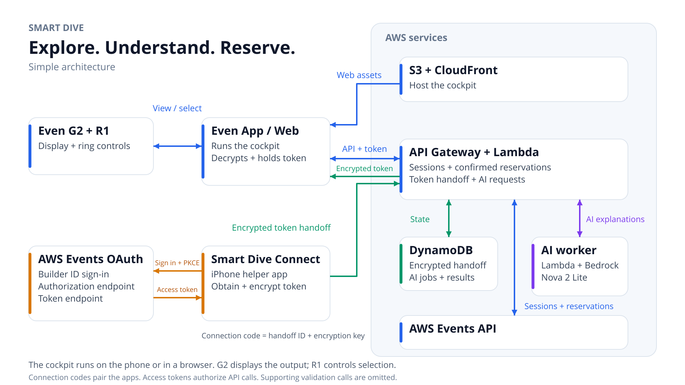
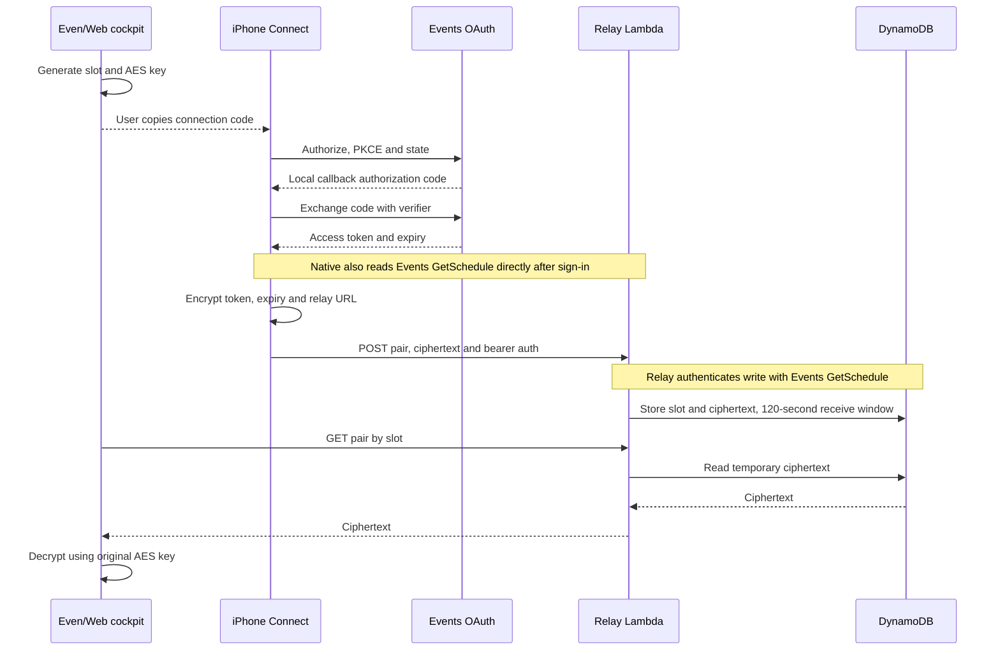
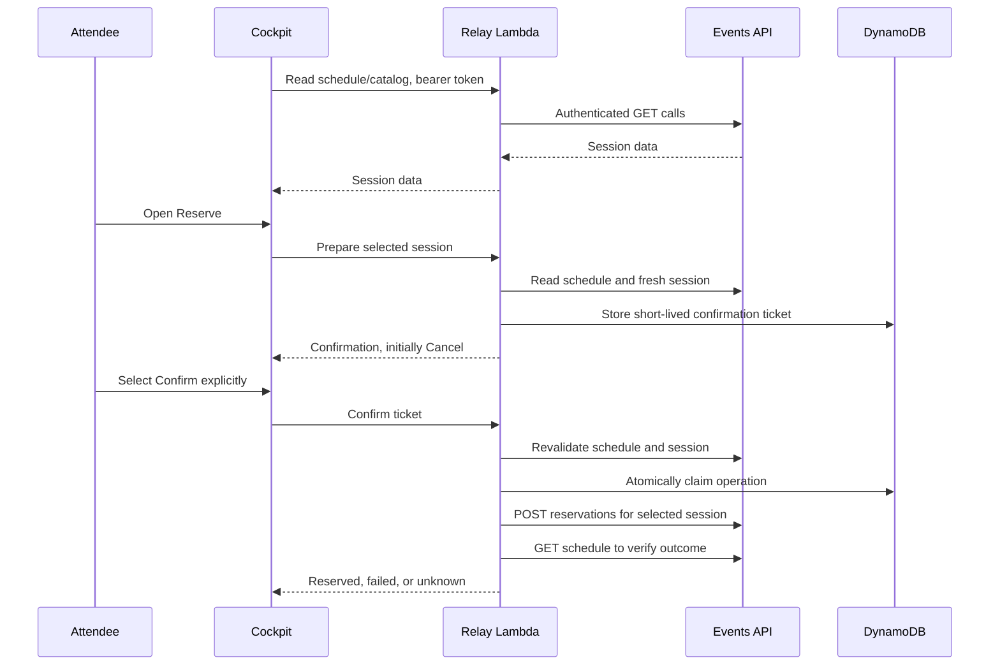
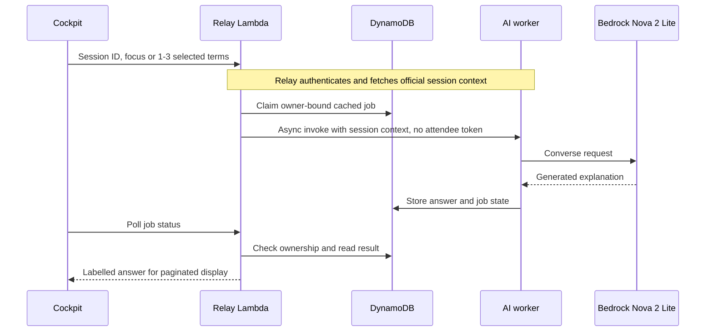

# Smart Dive architecture

This is a logical implementation diagram, not a network deployment boundary. G2 is a display/input accessory: the cockpit JavaScript executes in the Even phone app's WebView. Optional browser use shares the renderer and relay. The native helper is a separate iPhone app used for sign-in and handoff.

## Authentication and encrypted handoff

The key is not in the pair API payload. The relay does receive the bearer token for upstream authentication. A slot contains no pre-registered personal account. The connection code itself is not rewritten after authentication. DynamoDB TTL cleanup may occur after the code-enforced receive window.

## Session reads and explicit reservation

Preparation does not book a seat. HTTP 200 alone is insufficient to declare success. Unknown outcomes are not automatically resent. Deduplication is tied to the implementation's owner/session records, not a universal exactly-once claim.

## AI explanations

The cockpit normalizes common Markdown before paginating the shared Web/G2 display. Standard AI Dive is abstract-based. Keyword Dive adds general model knowledge to explain selected concepts together. Neither uses web search or retrieves unpublished lecture content. Only the normal user-confirmed reservation route writes reservations; the AI worker cannot book seats.

## Deployment and services

- CloudFront serves the guide/cockpit from an S3 bucket that blocks public access, using a scoped OAC bucket policy.
- API Gateway HTTP API invokes relay Lambda through method/path-scoped permissions.
- Relay and AI worker have separate roles. DynamoDB stores temporary pairing ciphertext, reservation state, and AI jobs/results.
- Bedrock uses Japan inference profile `jp.amazon.nova-2-lite-v1:0`; its allowed foundation-model regions are Tokyo and Osaka.
- Native OAuth goes directly to Events OAuth. Native sign-in also calls Events GetSchedule before the encrypted handoff. These calls do not go through CloudFront.
- AWS Events REST API reads and reservation writes go through relay for cockpit operation. MCP and AgentCore are not used.

Editable diagrams: Mermaid blocks above and `architecture.svg`. `architecture.png` is provided for article/video export. The diagrams use labelled service boxes rather than AWS trademark icon assets.
